<!--
  ARPAN ROY · PROFILE · VOL. 02 — "Kolkata night"
  Alpona gold, sindoor red & circuit teal on deep indigo.
  Static illustrations live in /assets. Live cards (stats + snake) are rebuilt
  every 12h by .github/workflows/profile.yml and served from the `output` branch.
-->

  <a href="https://arpanroy05.vercel.app/">
    
  </a>

  
  
  
  
  

<!-- § 01 — ABOUT -->


I'm a B.Tech student at **Government College of Engineering & Leather Technology, Kolkata** (2025 – 2029), building where **AI agents, Web3 and community** overlap. I like taking an idea from zero to a working product — and I care as much about the people around a product as the code inside it. The long game: **AI engineering**.



<!-- § 02 — WORK -->


  <a href="https://arpanroy05.vercel.app/"></a>
  <a href="https://arpanroy05.vercel.app/"></a>

  <a href="https://github.com/arg0506/Voxis"></a>
  <a href="https://github.com/arg0506/Devpulse"></a>

  <a href="https://arpanroy05.vercel.app/"></a>
  <a href="https://github.com/arg0506/MonadArena"></a>

  <a href="https://devpulse-lake-kappa.vercel.app">DevPulse live demo</a> · <a href="https://github.com/arg0506/Voxis">Voxis source</a> · <a href="https://github.com/arg0506/MonadArena">Monad Arena source</a> · <a href="https://arpanroy05.vercel.app/">everything else on the portfolio</a>

<b>✦ More from the archive</b>

 

| Fig. | Project | Notes | Tags |
|:--:|:--|:--|:--|
| 07 | **[BidForge](https://github.com/arg0506/BidForge)** | Decentralized auctions with live bids & multi-wallet support | `WEB3` `TS` |
| 08 | **[Orion](https://github.com/arg0506/Orion)** | Web3 wallet dashboard on Stellar Testnet with Freighter | `STELLAR` |
| 09 | **[Flowpilot](https://github.com/arg0506/Flowpilot)** | AI workflow automation with Soroban contracts & signed audit logs | `AI` `SOROBAN` |
| 10 | **[Qilo](https://github.com/arg0506/Qilo)** | Real-time multiplayer quiz app | `FLUTTER` `NESTJS` `SUPABASE` |
| 11 | **[Nutri-Mind](https://github.com/arg0506/Nutri-Mind)** | AI nutrition assistant with context-aware recommendations | `AI` |
| 12 | **Kairo** | Liquidity infrastructure for NFT markets | `MONAD` `DEFI` |
| 13 | **Nundina Express** | Waitlist campaign — every member gets a train-ticket identity | `COMMUNITY` |
| 14 | **KrishiMitra** | AI farming assistant for Bengali-speaking farmers | `AI` `VOICE` |
| 15 | **SurChain** | Music royalties & ownership onchain | `STELLAR` |
| 16 | **CarbonLens AI** | Trust scoring & fraud detection for carbon credits | `POLYGON` `AI` |
| 17 | **[Portfolio v1](https://github.com/arg0506/Portfolio-website)** | The earlier HTML/CSS portfolio | `WEB` |

<!-- § 03 — EXPERIENCE -->



<!-- § 04 — TOOLKIT -->



  

<!-- § 05 — SIGNAL -->


  

  

  

<!-- § 06 — BEYOND CODE -->



<!-- § 07 — CONTACT -->


  Open to select projects and roles, hackathon teams, and conversations about 
  <b>AI agents</b>, <b>DeFi</b> and <b>community growth</b>. Kolkata · GMT+5:30.

  
  
  

 

  

