<!--
  ARPAN ROY · PORTFOLIO · 2026 / VOL. 01
  Profile README styled to match arpanroy05.vercel.app.
  Keep the /assets folder in this repo — header.svg and footer.svg live there.
-->

<p align="center">
  <a href="https://arpanroy05.vercel.app/">
    
  </a>
</p>

<p align="center">
  <a href="https://arpanroy05.vercel.app/"></a>
  <a href="https://arpanroy05.vercel.app/Arpanroy_resumeup.pdf"></a>
  <a href="https://www.linkedin.com/in/arpan-roy-75955031a"></a>
  <a href="https://x.com/arg05_06"></a>
  
</p>

<br/>

<sub><code>§ 01 — ABOUT</code></sub>

## Turning ideas into products. *And people into communities.*

I'm a B.Tech student at **Government College of Engineering & Leather Technology, Kolkata** (2025 – 2029), working where **Web3, AI agents and community** overlap. I like taking an idea from zero to a working product, and I care as much about the people around a product as the code inside it.

|  |  |  |
|:--|:--|:--|
| **◐ Builder**<br/><sub>I build products that solve real problems, from idea to shipped.</sub> | **◑ Community**<br/><sub>I believe in people and good communities. I start clubs, run events and organize hackathons.</sub> | **◒ Curious**<br/><sub>I'm always learning and improving: DeFi, ZK, agents, growth.</sub> |

```txt
LOCATION    Kolkata, IN · 22.57° N, 88.36° E · GMT+5:30
NOW         Founder & Founding Engineer @ Automa
ALSO        Growth @ Nundina Finance · Stellar & Midnight Ambassador
STATUS      Available for select projects & roles
```

<br/>

<sub><code>§ 02 — WORK</code></sub>

## Ideas in progress. *Built with intention.*

<table>
<tr>
<td width="50%" valign="top">

<sub><code>FIG. 01 · FEATURED</code></sub>
### Automa ↗
Programmable financial infrastructure for **autonomous AI agents**. Agents can receive, hold and spend digital assets under programmable rules and human-set controls. It combines wallets, spending policies, transaction execution and monitoring in one layer.

<sub>`WEB3` · `AI` · `AGENTS` · `PAYMENTS`</sub>

</td>
<td width="50%" valign="top">

<sub><code>FIG. 02</code></sub>
### Nundina Finance ↗
A **private-credit secondary market**. I work on the growth team, covering brand, content, community and social strategy for a Web3 financial product.

<sub>`WEB3` · `DEFI` · `COMMUNITY`</sub>

</td>
</tr>
<tr>
<td width="50%" valign="top">

<sub><code>FIG. 03</code></sub>
### Vertex ↗
A **decentralized exchange on Stellar** focused on fast, streamlined onchain trading. It covers swap routing, order books and liquidity pools through Soroban.

<sub>`STELLAR` · `SOROBAN` · `DEFI`</sub>

</td>
<td width="50%" valign="top">

<sub><code>FIG. 04</code></sub>
### Kairo ↗
An exploration of **liquidity infrastructure for NFT markets** on Monad.

<sub>`DEFI` · `NFT` · `MONAD`</sub>

</td>
</tr>
<tr>
<td width="50%" valign="top">

<sub><code>FIG. 05</code></sub>
### [DevPulse ↗](https://github.com/arg0506/Devpulse)
A collaborative workspace for developers that combines **real-time chat**, a node-based **AI Agent Studio** (Gemini), a live **co-design sketchboard** and a browser terminal.

<sub>`REACT 19` · `TYPESCRIPT` · `SOCKET.IO` · `PRISMA` · `POSTGRES`</sub><br/>
<sub>[Live demo](https://devpulse-lake-kappa.vercel.app) · [Source](https://github.com/arg0506/Devpulse)</sub>

</td>
<td width="50%" valign="top">

<sub><code>FIG. 06</code></sub>
### Nundina Express ↗
A **community waitlist campaign** where each member gets a train-ticket identity. It's a growth experiment in making signing up feel like boarding.

<sub>`COMMUNITY` · `CAMPAIGN` · `WEB3`</sub>

</td>
</tr>
</table>

<details>
<summary><b>More from the archive →</b></summary>
<br/>

| Fig. | Project | Notes | Tags |
|:--:|:--|:--|:--|
| 07 | **[Monad Arena](https://github.com/arg0506/MonadArena)** | 2D multiplayer crystal-collecting browser game | `MONAD` `GAME` |
| 08 | **Voxis** | Privacy-preserving governance with ZK proofs | `MIDNIGHT` `ZK` |
| 09 | **Orion** | Web3 wallet dashboard | `STELLAR` |
| 10 | **SurChain** | Music royalty & ownership onchain | `STELLAR` |
| 11 | **KrishiMitra** | AI farming assistant for Bengali-speaking farmers | `AI` `VOICE` |
| 12 | **CarbonLens AI** | Trust scoring & fraud detection for carbon credits | `POLYGON` `AI` |
| 13 | **[Portfolio](https://github.com/arg0506/Portfolio-website)** | The earlier HTML/CSS portfolio | `WEB` |

</details>

<br/>

<sub><code>§ 03 — EXPERIENCE</code></sub>

## The journey so far. *And what's next.*

| Period | Role | Where | |
|:--|:--|:--|:--|
| `2024 — NOW` | **Founder & Founding Engineer** | Automa | <sub>Agents · Payments · Web3</sub> |
| `2024 — NOW` | **Growth Team** | Nundina Finance | <sub>Community · Content · Brand</sub> |
| `JUL 2026 — NOW` | **Ambassador** | Stellar Development Foundation | <sub>Developer & student engagement</sub> |
| `JUL 2026 — NOW` | **Ambassador** | Midnight | <sub>Privacy-chain education & campus events</sub> |
| `AUG 2026 — NOW` | **Lead** | AWS Student Builder Group, GCELT | <sub>Workshops on AWS, AI & emerging tech</sub> |
| `—` | **Founder** | Nakshatra Coding Club | <sub>Campus coding community</sub> |
| `—` | **Organizer** | College Hackathon | <sub>Built & ran the event</sub> |
| `2023 — 2024` | **Developer & Creator** | Freelance / Independent | <sub>Web3, product & DeFi exploration</sub> |

<br/>

<sub><code>§ 04 — TOOLKIT</code></sub>

## Learning. Building. *Growing.*

<p>
  <b><sub>CHAINS &nbsp;</sub></b>
  
  
  
  
  
</p>
<p>
  <b><sub>CONTRACTS &nbsp;</sub></b>
  
  
  
  
  
</p>
<p>
  <b><sub>FRONTEND &nbsp;</sub></b>
  
  
  
  
  
  
</p>
<p>
  <b><sub>BACKEND &nbsp;</sub></b>
  
  
  
  
  
  
</p>
<p>
  <b><sub>LANGUAGES &nbsp;</sub></b>
  
  
  
  
</p>

<br/>

<sub><code>§ 05 — SIGNAL</code></sub>

## Better products. *Bigger impact.*

<p align="center">
  
  
</p>

<p align="center">
  
</p>

<p align="center">
  
</p>

<br/>

<sub><code>§ 06 — CONTACT</code></sub>

## Let's build something. *Together.*

I'm open to select projects and roles, hackathon teams, and conversations about agents, DeFi and community growth.

<p>
  <a href="mailto:arpanroy0506@gmail.com"></a>
  <a href="https://www.linkedin.com/in/arpan-roy-75955031a"></a>
  <a href="https://x.com/arg05_06"></a>
</p>

<br/>

<p align="center">
  
</p>

<p align="center"><sub><code>ARPAN ROY · SOFTWARE ENGINEER & BUILDER · KOLKATA, IN · VOL. 01</code></sub></p>
